<!-- Designed & engineered by Aman Jha · github.com/codingtravis-aman -->
<div align="center">


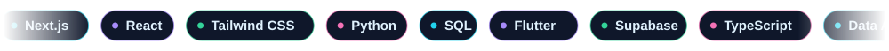

<a href="https://amancreates.netlify.app/"></a>
<a href="https://github.com/codingtravis-aman"></a>



</div>

```bash
$ whoami
aman-jha  # full-stack developer & data analyst

$ cat interests.txt
cyber-security  open-source  automation

$ ./status --now
building   -> scalable web & mobile apps (Next.js · Flutter · Supabase)
learning   -> web security, one lab at a time
available  -> collaborations, open-source & freelance
```

<div align="center">


**🎨 Frontend**<br/>


**🗄️ Backend & Database**<br/>


**📱 Mobile & DevOps**<br/>


**📊 Tools & Analytics**<br/>


<br/>


<table align="center">
  <tr>
    <td align="center" width="33%">
      <a href="https://amancreates.netlify.app/">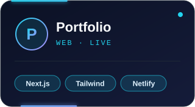</a>
      <br/><sub>Personal portfolio showcasing projects, skills and case studies in a fast, responsive UI.</sub>
      <br/><a href="https://amancreates.netlify.app/"><b>Live Demo</b></a> &nbsp;•&nbsp; <a href="https://github.com/codingtravis-aman/portfolio"><b>Repo</b></a>
    </td>
    <td align="center" width="33%">
      <a href="https://github.com/codingtravis-aman/niyati">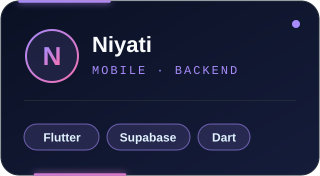</a>
      <br/><sub>Palm-scan mobile app with a guided camera viewfinder and a server-authoritative Supabase backend.</sub>
      <br/><a href="https://github.com/codingtravis-aman/niyati"><b>Repo</b></a>
    </td>
    <td align="center" width="33%">
      <a href="https://github.com/codingtravis-aman/bhartfix">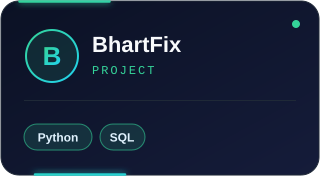</a>
      <br/><sub>One crisp sentence on what BhartFix does and the problem it solves.</sub>
      <br/><a href="https://github.com/codingtravis-aman/bhartfix"><b>Repo</b></a>
    </td>
  </tr>
</table>

<br/>



<br/><br/>


<br/><br/>


<br/>

<details>
<summary><b>🧬 How this profile works (click to open)</b></summary>
<br/>

Every animated element on this page is hand-written SVG hosted in this repo.<br/>
The stats card is generated by a Python script run by **GitHub Actions** every day,<br/>
and the contribution snake is rebuilt every 12 hours.

</details>

<br/>


<a href="https://amancreates.netlify.app/"></a>

<br/><br/>


</div>
